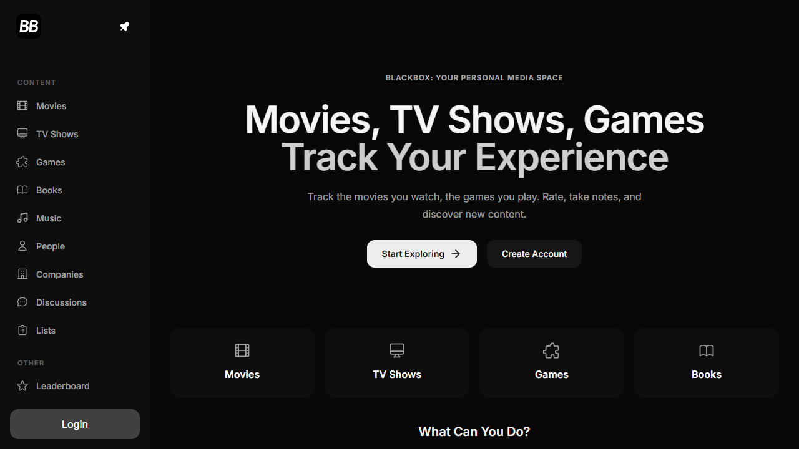

<div align="center">
  

# BlackboxDB

**Your personal space for the stories you follow.**

Catalog movies, shows, games, books, and more in a self-hosted media tracker.

[](https://github.com/kargalar/BlackboxDb) [](LICENSE) [](https://github.com/kargalar/BlackboxDb/issues)

[Explore the project](https://github.com/kargalar/BlackboxDb) · [Build from source](#build-from-source) · [Report an issue](https://github.com/kargalar/BlackboxDb/issues)

</div>



## Keep your media life in one place

Search and organize the titles you watch, play, read, and listen to. Save ratings and notes, build lists, and discover what to explore next through a responsive web interface.

## Features

- Browse and search movies, TV shows, games, books, music, people, and companies.
- Keep personal lists, ratings, reviews, and activity logs.
- Explore recommendations, discussions, quizzes, and related content.
- Use a responsive Next.js interface with theme support.
- Run the GraphQL API and Prisma-backed catalog on your own infrastructure.

## Run locally

Requirements: Node.js 20 or later, npm, and a configured database.

Copy the sample environment files and set your local API and database values:

```sh
cp web/.env.example web/.env.local
cp server/.env.example server/.env
```

Install dependencies, then start the API and frontend using the project start scripts or run each service from its directory. The web app runs with:

```sh
cd web
npm install
npm run dev
```

## Build from source

Run frontend checks from `web/`:

```sh
npm run typecheck
npm run lint
npm test
npm run build
```

Keep real environment files, database backups, private media catalogs, and API secrets out of version control. Configure production credentials through your hosting provider's secret store.

## License

BlackboxDB is licensed under the GNU General Public License v3.0. See [LICENSE](LICENSE).
